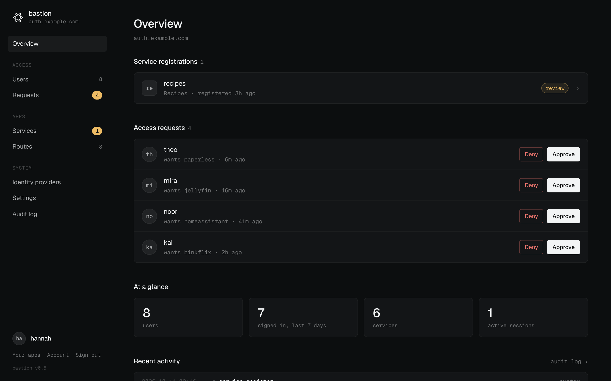
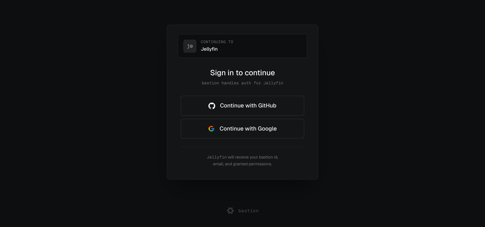
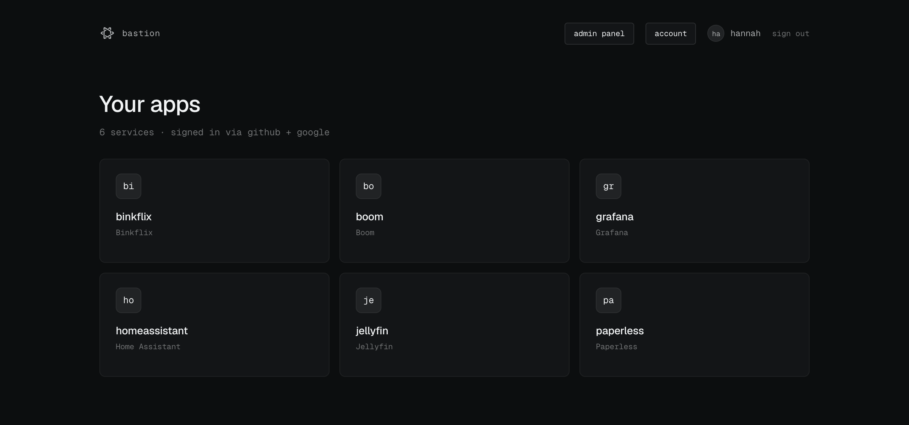
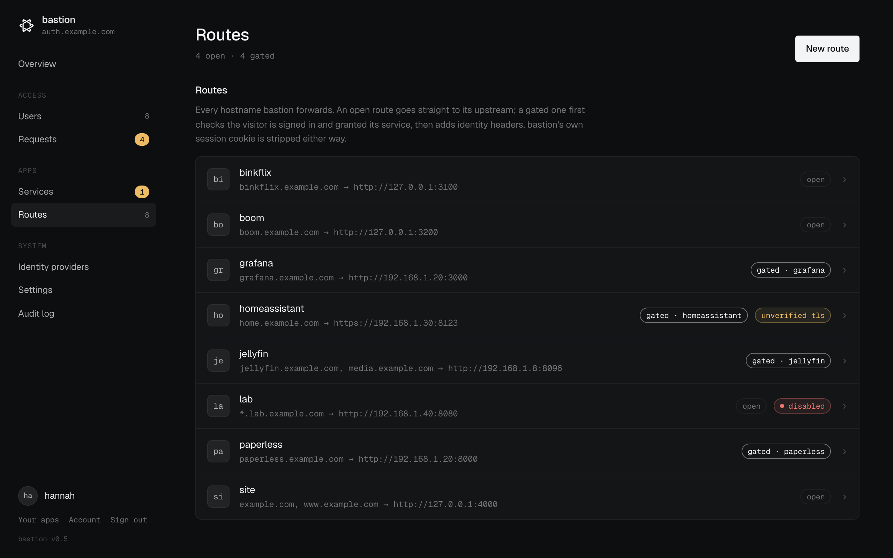
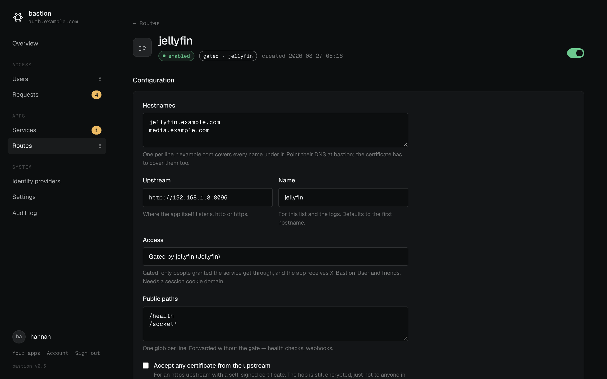
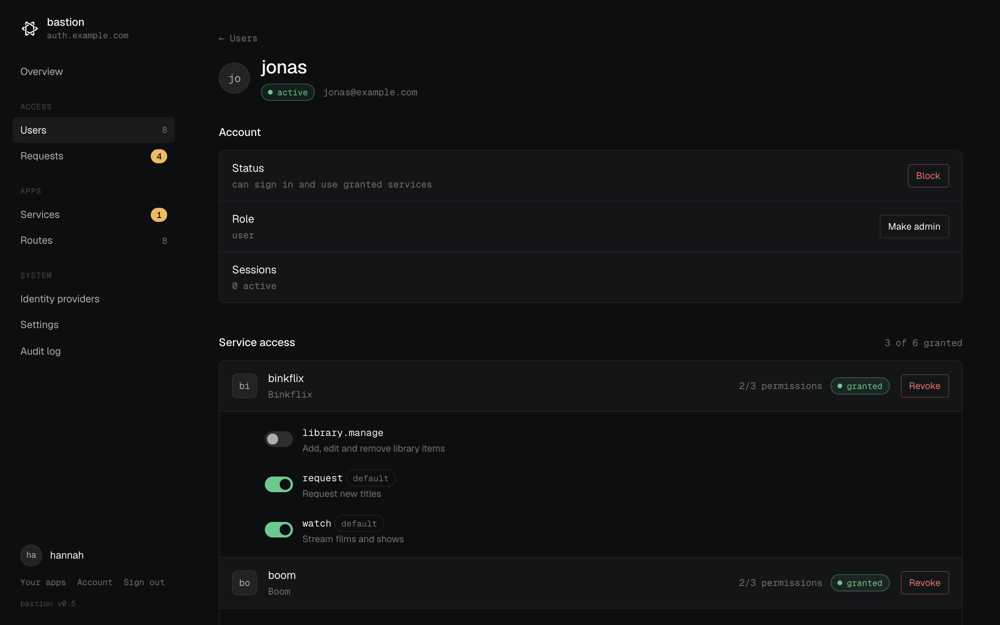
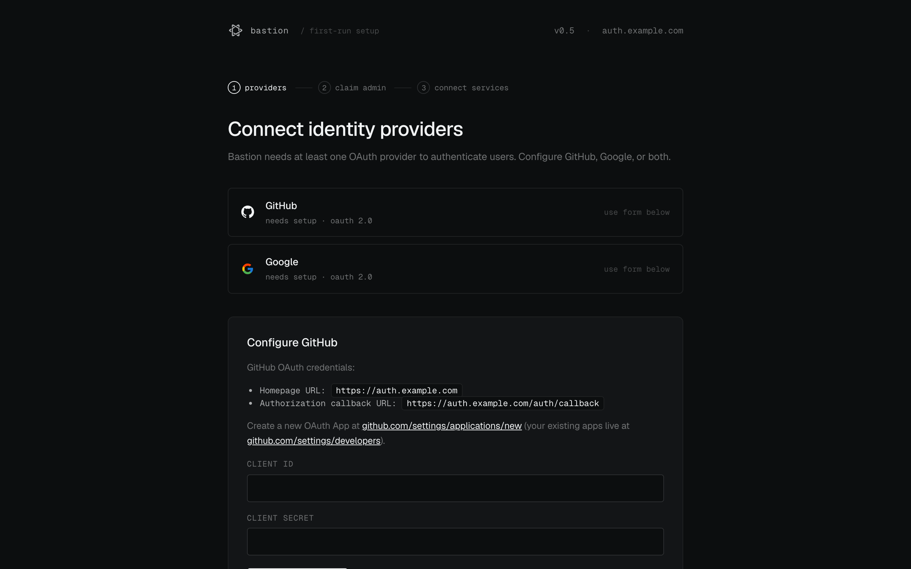
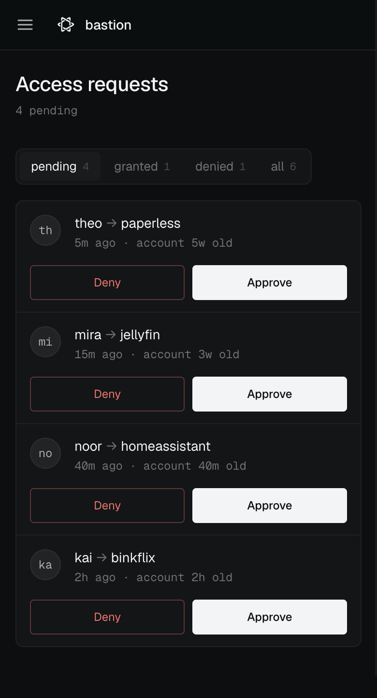

<h1 align="center">bastion</h1>

<p align="center">
  Single sign-on and a TLS edge for self-hosted apps.<br>
  Sign in once with GitHub or Google, and decide who gets into what.
</p>

<p align="center">
  
</p>

bastion sits in front of the apps on your box. People sign in with GitHub or Google, ask for access to an app, and you approve or deny them from one admin panel. Apps get the signed-in user either as a **signed JWT** (if they want to know about bastion) or as **plain headers** on a proxied request (if they don't). bastion can also terminate TLS and route every hostname on the box, so it can replace nginx or Caddy.

It's a single Rust binary and a SQLite file. Everything apart from ports and certificates is configured in the browser.

## Features

- **GitHub and Google sign-in.** Use either or both. A user can link several identities to one account, and apps always see the same stable user id.
- **Access requests.** New users ask for an app and an admin approves or denies them. Revoking access takes effect on the next request.
- **Gate any app.** Put a route in front of something that has never heard of bastion (Grafana, Jellyfin, Paperless, Home Assistant). Only granted users get through, and the app receives `Remote-User` / `X-Bastion-User` headers.
- **Or integrate properly.** Apps that verify bastion's RS256 JWT get per-service **permissions** they declare themselves, with defaults and per-user overrides.
- **TV and CLI sign-in.** Apps with no browser of their own show a code (or a QR code), and someone confirms it on their phone. The device gets the same JWT a browser would, and can be signed out from the account page.
- **Edge mode.** Terminate TLS, route hostnames and `*.wildcards` to upstreams (http or https, self-signed allowed), and keep some routes open and others gated. Certificates hot-reload when your DNS-01 client renews them.
- **Built for a phone.** The admin panel is responsive, so you can approve a request from the couch.
- **Setup wizard.** No config files. Start it, open it, and follow three steps.

## Screenshots

| | |
|---|---|
|  |  |
| **Sign in** once, on bastion's own hostname | **Your apps**: everything you've been granted |
|  |  |
| **Routes**: hostnames to upstreams, open or gated | **A route**: wildcards, public paths, https upstreams |
|  |  |
| **Users**: grants and fine-grained permissions | **First run**: a three-step wizard |

<p align="center">
  
</p>

## Quick start

```yaml
# compose.yaml
services:
  bastion:
    image: ghcr.io/ria8651/bastion:latest   # amd64 + arm64
    environment:
      ORIGIN: https://auth.example.com
    volumes:
      - bastion_data:/data
    ports:
      - "127.0.0.1:5180:5180"
    restart: unless-stopped
volumes:
  bastion_data:
```

```sh
docker compose up -d
```

Open bastion and the setup wizard walks you through it:

1. **Connect a provider.** Create a GitHub OAuth app and/or a Google OAuth client. The wizard shows the exact callback URL to paste in.
2. **Claim admin.** Sign in with the provider you just connected to become the first admin.
3. **Add services.** Add the apps people can request access to.

This runs bastion behind an existing reverse proxy that terminates TLS and forwards `X-Forwarded-Proto`/`X-Forwarded-Host`, or set `ORIGIN` as above. To have bastion do TLS itself, see [Edge mode](#edge-mode).

## Putting apps behind it

A **service** is who may get in: a name, grants, access requests and a launcher tile. A **route** is where traffic goes: hostnames and an upstream. An app can use either or both.

### Option A: gate an app that knows nothing about bastion

No code changes in the app. bastion answers on the app's hostname, checks the session and the grant, and forwards the request with the user attached:

| Header | Value |
|---|---|
| `X-Bastion-User`, `Remote-User` | username |
| `X-Bastion-Email`, `Remote-Email` | email |
| `X-Bastion-Sub` | stable user id (same as the JWT `sub`) |

To set one up:

1. In **Settings**, set a **session cookie domain** covering bastion and the app (e.g. `example.com`), and pin `ORIGIN`.
2. **Services → New service** (no return URL needed).
3. **Routes → New route**: hostname `grafana.example.com`, upstream `http://192.168.1.20:3000`, access *gated by* that service. Point the DNS at bastion.

Clients can't forge these headers. bastion builds the outbound headers from scratch and drops anything named `X-Bastion-*` or `Remote-*` from the incoming request. bastion's own session cookie is stripped too, so the app never sees it. Health checks and webhooks can skip the gate with **public paths** (`/health`, `/api/hooks/*`).

### Option B: verify bastion's JWT

For apps you write yourself, when you want permissions:

1. Send signed-out users to `https://auth.example.com/auth/login?service=<slug>`.
2. bastion signs them in, checks the grant, and redirects to the service's return URL with `?bastion_token=<JWT>`.
3. Verify the token against `/.well-known/jwks.json` (RS256). Check `iss`, and `aud` = `svc` = your slug. Then start your own session.

Claims: `sub`, `username`, `perms[]`, `bastion_uid`, `aud`, `svc`, `iss`, `iat`, `exp`, `jti`. For checks that must notice a revocation before the token expires, call `GET /api/introspect` with `Authorization: Bearer <jwt>`.

### Devices without a browser

A TV app or CLI can't run an OAuth redirect, so it signs in on someone's phone instead, using the OAuth device flow ([RFC 8628](https://www.rfc-editor.org/rfc/rfc8628)). Turn on **Device sign-in** on the service's admin page first; it's off by default.

1. `POST /api/device/code` with `client_id=<slug>&name=Living Room TV` (form-encoded). You get back a `user_code`, a `verification_uri_complete` to show as a QR code, a `device_code` and a polling `interval`.
2. The user opens `/device` on their phone, signs in, checks the code and confirms.
3. Meanwhile, poll `POST /api/device/token` with `grant_type=urn:ietf:params:oauth:grant-type:device_code&client_id=<slug>&device_code=…`. It answers `authorization_pending` until the user confirms, then returns an `access_token` (the usual JWT, with an extra `device_id` claim) and a `refresh_token`.
4. Send the JWT as `Authorization: Bearer`. Before it expires (15 minutes), swap the refresh token for a new one with `grant_type=refresh_token&client_id=<slug>&refresh_token=…`.

Every refresh re-checks the user, the grant and the permissions, so revoking any of them reaches the device within one token lifetime. `/api/introspect` reports a signed-out device straight away. Devices unused for 90 days have to pair again.

An app can **register itself** on first boot by posting its public key and permission catalog to `/api/services/register`. It then shows up in the admin panel for approval.

## Edge mode

Set `TLS_CERT` and `TLS_KEY`, publish ports 80 and 443, and bastion becomes the front door for the whole box:

```yaml
    environment:
      ORIGIN: https://auth.example.com
      TLS_CERT: /certs/fullchain.pem
      TLS_KEY: /certs/privkey.pem
    volumes:
      - bastion_data:/data
      - /etc/letsencrypt/live/example.com:/certs:ro
    ports:
      - "80:80"
      - "443:443"
```

- Routes match the exact hostname first, then the most specific `*.wildcard`.
- WebSockets, SSE and other `Upgrade` connections are passed through. Bodies are streamed, not buffered.
- Upstreams can be `https://`, optionally accepting a self-signed certificate.
- Port 80 redirects to https for any hostname bastion serves.

bastion doesn't issue certificates. Point it at whatever your DNS-01 client (or private CA) writes and it picks up renewals within a minute, with no restart. **Renewals must use DNS-01**, because bastion holds port 80 and redirects everything, so HTTP-01 challenges never reach a webroot. If a renewed pair fails to load, the old one keeps serving and the error shows on the settings page.

## Configuration

Listeners and TLS are set through the environment, so a mistake there can't lock you out of the admin UI you'd need to fix it. Everything else lives in the database.

| Variable | Default | |
|---|---|---|
| `ORIGIN` | from request headers | bastion's public URL, e.g. `https://auth.example.com`. Required for gated routes and edge mode. |
| `DATABASE_PATH` | `./data/bastion.db` (`/data/bastion.db` in Docker) | SQLite file |
| `PORT` | `5180` | Plaintext HTTP listener, always on |
| `TLS_CERT`, `TLS_KEY` | | PEM chain and key. Setting both enables edge mode. |
| `HTTPS_PORT` | `443` | Edge mode only |
| `HTTP_PORT` | `80` | Edge mode only. Redirects to https. `off` disables it. |
| `TRUSTED_PROXIES` | `none` in edge mode, otherwise loopback + private ranges | IPs/CIDRs whose `X-Forwarded-*` headers are believed |
| `RUST_LOG` | `info,sqlx=warn,tower_http=info` | Log filter |

## Development

```sh
cargo run    # http://localhost:5180
```

Migrations in `migrations/` run on startup. The stack is axum, sqlx (SQLite), maud templates, htmx and josekit, with no JS build step. [`CLAUDE.md`](CLAUDE.md) has the architecture notes and the security invariants behind the proxy.
